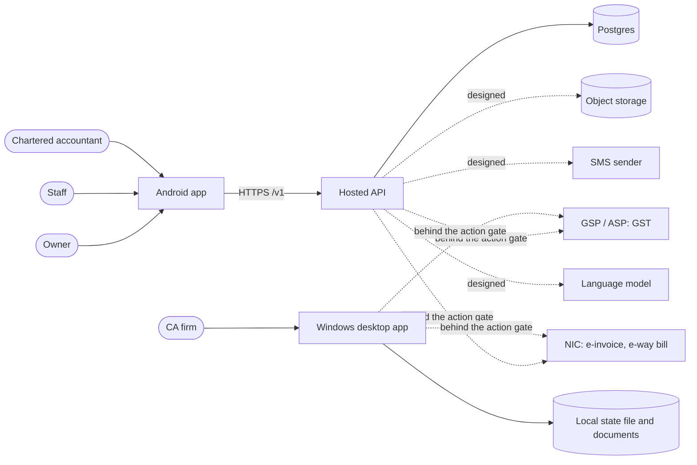
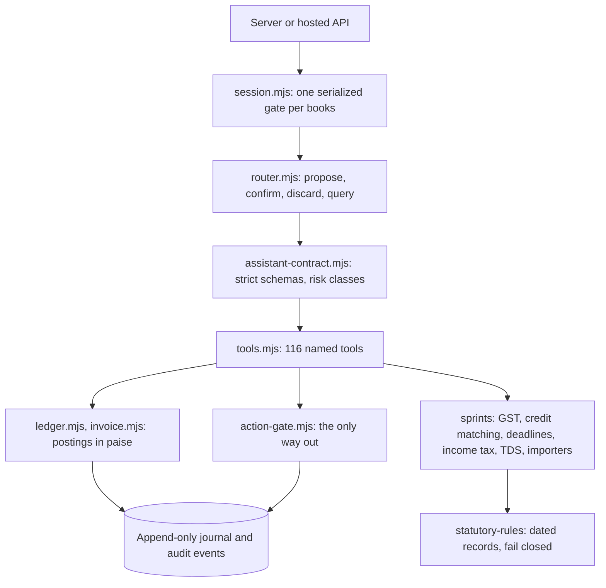

# System architecture

| | |
|---|---|
| Version | 1.0, 6 October 2026 |
| Scope | The whole system as it exists in this repository, and what is designed but not built |
| Related | [Data model](DATA-MODEL.md), [Security and privacy](SECURITY-AND-PRIVACY.md), [Decision records](decisions/), [cloud backend design](../superpowers/specs/2026-10-06-cloud-backend-design.md) |

## 1. In one paragraph

One accounting and compliance engine, written once in dependency-free Node, runs in two
hosts. On Windows it runs behind a local server inside an Electron app with a JSON file
for state. In the hosted service it runs once per request inside a Postgres transaction
that locks one business's books. An Android app talks to the hosted service. The engine
computes every figure from dated statutory rules; clients and the chat layer can only
call named, schema-checked tools; anything that would leave the system passes one gate.

## 2. Context



Solid lines exist and are tested. Dotted lines are either gated and sandbox-only, or
designed and not built.

## 3. Containers

| Container | Path | Technology | State | Status |
|---|---|---|---|---|
| Engine | `platform/src/` | Node 22, ESM, zero runtime dependencies | None of its own; works on stores it is given | Built, 591 tests |
| Statutory rules and engines | `sprints/` | Same | Rule records and golden cases in the repo | Built, 329 tests; frozen unless a task targets them |
| Desktop app | `platform/desktop/`, `platform/src/server.mjs` | Electron, local HTTP on 127.0.0.1 | JSON state file, content-addressed documents, encrypted credential and PIN vaults | Built |
| Hosted API | `cloud/` | Node 22, one dependency (`pg`) | Postgres | Built, 77 tests against a local Postgres; not deployed |
| Android app | `mobile/` | Flutter 3.44, Dart 3.12 | Refresh token in the Android keystore; preferences | Built, 131 tests; never run on a device |
| Infrastructure | `infra/`, `.github/workflows/` | Terraform, GitHub Actions | | Marketing site and Windows release only; nothing for the hosted API |

## 4. The engine



### Rules the engine keeps

- **The invoice is the source of truth.** The trial balance and every return are
  projections of posted documents, computed on demand.
- **Money is integer paise.** Rupees appear only at the edges.
- **The journal is append-only** with a checksum chain. Corrections are new entries.
- **Statutory values are dated records** with act, section and source. Asking for a
  rule outside its dates returns `RULE_NOT_IN_FORCE`; nothing falls back to a default.
- **Engines return errors, they do not throw**: `{ ok: false, error: 'CODE' }`.
- **No clock and no randomness inside rule and flag engines.** Dates are arguments.
- **Chat cannot post.** A message that would change the books becomes a pending
  proposal; a separate confirm call applies it.

### Stores

The engine reads and writes through two ports (`store-ports.mjs`): a books store (the
state as text plus a version) and a document store (bytes by sha256). The desktop
supplies file-backed stores; the hosted API supplies in-memory stores filled from, and
written back to, one database row. A stale version is refused with `VERSION_CONFLICT`.

### Books and tenancy inside the engine

On the desktop one state file holds the firm's own books and an isolated book per
client. Tools run against `bookView(root, book)`, a Proxy that routes book keys to the
active client and firm keys to the root, and throws on an unclassified write. In the
hosted service every business has its own state, so the view is always the root.

## 5. The hosted API

### One request

```mermaid
sequenceDiagram
  participant App
  participant API as api.mjs
  participant DB as Postgres
  participant Eng as Engine session

  App->>API: POST /v1/businesses/:id/propose (bearer token)
  API->>DB: verify device and user, check membership
  Note over API,DB: Not a member: 404, same as not found
  API->>DB: BEGIN, SELECT books FOR UPDATE
  API->>Eng: open session on in-memory stores, actor = caller
  Eng-->>API: preview, new state
  API->>DB: UPDATE books, INSERT audit_log, COMMIT
  API-->>App: preview and a confirmation token
  App->>API: POST .../confirm (token)
  Note over API,Eng: Same transaction pattern; the engine replays the held proposal
```

Locking the one books row serializes writers for a business and leaves other businesses
untouched. The cost is that the whole state is read and written per request; see
section 9.

### Surface

| Area | Routes under `/v1` |
|---|---|
| Sign-in | `auth/methods` (which methods are on), `auth/google`, `auth/otp`, `auth/verify`, `auth/refresh`, `auth/logout` |
| Account | `me` (read, rename, delete) |
| Businesses | `businesses` (list, create), `reference/states` |
| Books | `businesses/:id/snapshot`, `propose`, `confirm`, `discard`, `query`, `ask`, `company`, `uploads` |
| People | `businesses/:id/members`, `invitations`; `invitations/:id/accept` and `decline`; delete a member or an invitation; `ca-sync` and `ca-share` (what an accountant sees) |
| Crash reports | `crash-reports` (signed in; no business; see SECURITY-AND-PRIVACY.md) |
| Privacy | `privacy-notice` (public); `me/consent`. Until the current notice is accepted, every route except `me`, `me/consent`, `crash-reports` and the state list answers 403 `CONSENT_REQUIRED` |

Only twenty-seven tools can be proposed remotely (`create_invoice`, `create_purchase`,
`record_receipt`, `record_payment`, `record_filing`, `record_supplier_reminder`,
`add_employee`, `change_salary`, `end_employment`, `set_tds_deductor`, `record_tds_deposit`, `post_expense`, `set_expense_head`, `create_credit_note`,
`cancel_invoice`, `gst_review_answer`, `add_reminder`, `complete_reminder`,
`set_cash_balance`, `set_payment_terms`, `ask_ca`, `reply_ca`, `close_ca`,
`create_quote`, `mark_quote`, `convert_quote`, `exception_decide`), plus the importers by document
hash. Only the read tools in `remote-contract.mjs` can be queried. Everything else in
the catalogue is unreachable from the network.

### Sign-in

A six-digit code to the phone, valid five minutes, five tries, five codes an hour. A
successful verify issues a 15-minute signed access token and a 60-day refresh token
bound to the device. Refresh rotates the token; presenting an old one revokes the
device. No SMS sender exists yet: codes print to the console when `MYCA_DEV_OTP=1`, and
the server refuses to start without it.

## 6. The Android app

- `MycaApi` is one interface with two implementations: the local desktop server (for
  development) and the hosted session (`cloud/cloud_session.dart`).
- `AppState` owns the snapshot, the lock and onboarding flags; screens read it through
  `AppScope`.
- Every write is `propose` then `confirm`; the app never computes tax or a total. It
  formats what the engine returns.
- The refresh token lives in the Android keystore. The app lock uses the device's
  fingerprint or screen lock.
- Design tokens, the logo mark and the icon set are code (`theme.dart`, `brand.dart`,
  `marks.dart`); Inter is bundled.

## 7. The action gate

The only path to an external system, in both hosts. In order: the action is known; the
assistant is not attempting a blocked write; the parameters are plain JSON; the
preflight passes; a mock fixture answers when the live switch is off; the live switch
(`MYCA_ENABLE_LIVE_CALLS`) is on; an approval exists that is bound to the operation,
the business and a hash of the payload; the approver is not the requester and holds an
approver role; the deadline has not passed; and the outcome, including an unknown
outcome on timeout, is audited. An architecture test fails if any transport is
reachable without it.

The hosted server refuses to start with the live switch set, because per-business
provider credentials do not exist there yet.

## 8. Quality gates

| Gate | Command | Covers |
|---|---|---|
| Everything | `node scripts/check-all.mjs` | Platform, every engine, hosted API if Postgres is reachable, app analysis and tests |
| Platform | `cd platform && npm test` | 591 tests |
| Hosted API | `cd cloud && npm test` | 77 tests; each file creates and drops its own database |
| App | `cd mobile && flutter analyze && flutter test` | 131 tests |
| Stress | `cd platform && npm run stress` | Permanent stress harness |

There is no linter or type checker for the Node code; the suites are the gate. CI
definitions exist for all of the above, but GitHub Actions is not running on the
account at present, so the local command is the gate of record.

## 9. Known limits and the plan for each

| Limit | Effect | Plan |
|---|---|---|
| Whole books state in one row, rewritten per request | Fine for a small business; slow for a shop with tens of thousands of invoices | Split documents and journal into tables (phase C2 in the cloud design) |
| Queries append an audit event | Every read is a write | Separate read path that does not persist |
| One pending proposal per business | Two members previewing at once replace each other's preview | Key proposals by member and device |
| Document bytes in Postgres, 8 MB per upload | No large scans | Object storage with direct uploads |
| Chat is rule-based | Free text beyond known phrasings is not understood | Model that selects tools under the existing contract (ADR-0004) |
| No set-off of credit against tax | No "amount to pay" | Dated set-off rules with golden cases (feature spec 03) |
| A requester cannot approve their own external action | A one-person business cannot file | Product decision (PRD Q2) |
| Not deployed | No real users | Needs a Google Cloud project; Terraform to be written |
| App untested on hardware | File picker, save dialog and fingerprint prompt are unverified | A phone on USB |

## 10. Deployment (designed, not built)

Google Cloud, Mumbai region (asia-south1). Cloud Run for the API, Cloud SQL for
Postgres, Cloud Storage for documents, Secret Manager for the token secret and provider
credentials, all in one project per environment. The desktop app continues to be built
by GitHub Actions as a Windows installer and does not use the hosted service. Details:
[cloud backend design](../superpowers/specs/2026-10-06-cloud-backend-design.md) and
[`DEPLOYMENT.md`](../../DEPLOYMENT.md).
