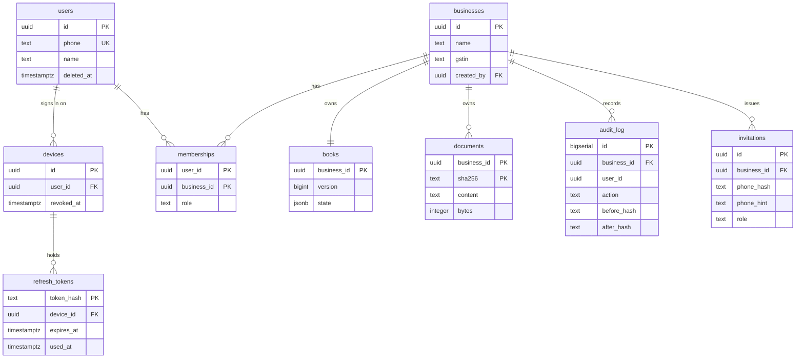

# Data model

| | |
|---|---|
| Version | 1.0, 6 October 2026 |
| Sources | `cloud/migrations/*.sql`, `platform/src/book-view.mjs`, `platform/src/ledger.mjs`, `platform/src/store.mjs` |

There are two layers. The **account layer** (who may see which business) is relational
and exists only in the hosted service. The **books layer** (the accounting state of one
business) is one document owned by the engine, stored as a row in the hosted service
and as a file on the desktop.

## 1. Account layer (hosted, Postgres)

| Table | Notes |
|---|---|
| `users` | One per phone number or Google account (`google_sub`, the account's stable id); every user has at least one. The phone number is stored as given, because it is the sign-in identifier. `email` is kept only when Google says it is verified. |
| `devices`, `refresh_tokens` | A session belongs to a device. Only a hash of the refresh token is stored. Reuse of a spent token revokes the device. The user sees every device of theirs with a live refresh token in the app and can end any of them. |
| `otp_challenges` | Salted hash of the code and a hash of the phone number; attempts are counted. |
| `user_totp`, `recovery_codes`, `second_step_challenges` | Optional two-step sign-in. `user_totp` holds one authenticator key per user, sealed with AES-256-GCM under a key derived from the service key and the user id, the enrolment attempt count, and the last accepted step so a code works once. `recovery_codes` holds a keyed hash per code, marked when used. `second_step_challenges` is the pending sign-in between the first factor and the authenticator code: five minutes, five attempts, consumed on success, deleted by the nightly job after a day. The first two are deleted when two-step is turned off or the account is deleted. |
| `businesses`, `memberships` | Role is `owner`, `staff` or `accountant`. A business keeps at least one owner. |
| `invitations` | Stored against a hash of the invited number plus a three-digit hint. One open invitation per business and number. |
| `books` | The engine's state for one business and a version that increases on every write. Deleting a business with books is restricted. |
| `documents` | Uploaded files by sha256, per business. Text content for now; object storage is planned. |
| `shared_books`, `businesses.ca_sync` | What an accountant sees when the owner chooses intervals: one copy of the books per business, the moment it stands for, when and why it was taken. |
| `audit_log` | Append-only. Triggers refuse update, delete and truncate. |
| `consents` | Which version of which notice a user accepted, when, and on which device. Kept as proof of consent. |
| `crash_reports` | Scrubbed crash reports, one row per crash and app version with a count. No user, device or business. Deleted 90 days after a crash was last seen. |

## 2. Books layer (the engine's state)

The same shape in both hosts. Keys are classified in `book-view.mjs`; an unclassified
key cannot be written through a view.

### Per business ("book keys")

| Key | Holds |
|---|---|
| `company` | Name, GSTIN, state, address, filing scheme |
| `ledger` | Accounts and the append-only list of transfers, with the checksum chain |
| `parties`, `vendors` | Customers and suppliers, identified by GSTIN where they have one |
| `invoices`, `purchases` | Posted documents with lines, tax heads, place of supply, receipts |
| `invoiceSeq`, `billSeq`, `transferSeq` | Number sequences |
| `imports` | What has been imported, for idempotency |
| `lockThrough` | The date up to which the period is locked |
| `attachments` | Metadata for attached documents; bytes are in the document store |
| `pendingChatAction`, `lastConfirmation` | The one held proposal and the last confirmed one, so a confirm can be replayed safely |
| `exceptions`, `exceptionSeq` | The exception queue |
| `purchases[].payments` | Payments to the supplier against a bill: amount, date, bank or cash. The bill is `partial` until nothing is owed, then `paid` |
| `supplierReminders`, `supplierReminderSeq` | GSTR-2B reminders the owner sent from their phone: supplier, month, bills, the message as sent, whether it was edited, who sent it and when |
| `tdsEntries`, `tdsDeposits` | Every bill or expense that carried a TDS section (PAN, section, base, TDS, the rules used), including those under the limit, and each deposit with its challan |
| `employees`, `employeeSeq` | Employees: details, PF/ESI membership, professional tax state, tax regime if stated, dated salary history in parts, last day if they left. Owner only |
| `filings` | Returns recorded as filed outside MyCA: return, period, ARN, filing date, due date, whether late, and who filed it |
| `quotes`, `quoteSeq` | Quotations: lines and tax as on an invoice, validity, state, and the invoice they became |
| `caRequests`, `caRequestSeq` | Questions for the CA: subject, the facts the engine attached, the messages with who and when, status |
| `customerTerms` | Payment terms in days per customer, keyed by GSTIN or by name |
| `cashReadings` | Bank and cash balances the owner stated on a day, used as the forecast's starting point; never posted to the ledger |
| `reminders`, `reminderSeq` | The owner's reminders: text, day, what it is about, who set it, when it was done |
| `gstr2b` | Per month: the GSTR-2B rows the owner added, with the file name and date added |
| `gstReviews` | Per tax period: the draft hash the owner reviewed, each step's answer with who and when, and the approval |
| `creditNotes`, `creditNoteSeq` | Credit notes against sales invoices, each linked to its invoice |
| `expenses`, `expenseSeq`, `expenseTags` | Posted expenses with their heads, and the owner's remembered head choices per payee and wording |

### Per installation ("firm keys", desktop only in practice)

`firmUsers`, `clients`, `extraBooks`, `activeClientId`, `approvals`, `auditEvents`,
`integrationConnections`, `outbox`, `dryRuns` and their sequences. In the hosted
service, people and roles come from the account layer and are passed in as the actor
for each request.

### A transfer

A transfer moves an integer number of paise from one account to another, has an
idempotent id, a date, a status (pending, posted or void), an optional link to other
transfers that must post together, and a checksum that includes the previous
transfer's checksum. Balances are always derived from transfers; they are never stored
as truth.

### Documents and returns

Invoices, purchases and credit notes are stored; returns are not. GSTR-1, GSTR-3B, the trial balance
and the period summary are computed from the stored documents each time they are asked
for, for one tax period chosen by document date.

## 3. Statutory rules

Rule records live in the repository, not in the database: `sprints/statutory-rules`.
Each record has an id, the act and section, the source, the dates it is in force, its
value and its attestations. Golden case files (`golden/gst.json`, `income-tax.json`,
`tds.json`, `deadlines.json`) pin the arithmetic. A change in the law is a code change
with a review, a test and a release, not a data edit in production.

## 4. On the desktop

| What | Where |
|---|---|
| State | `%APPDATA%\MyCA\state.json`, written atomically |
| Documents | `%APPDATA%\MyCA\documents\`, named by sha256, verified on every read |
| Provider credentials | Encrypted vault (`credential-vault.mjs`: OS key store, AES-256-GCM fallback) |
| PIN records | Encrypted `state.pins`, never in `state.json` or in a backup |

## 5. On the phone

| What | Where |
|---|---|
| Refresh token | Android keystore |
| Onboarding and lock preferences | Shared preferences |
| Books | Not stored. The app holds the last snapshot in memory only. |

There is no offline mode. An offline cache needs a decision on conflict handling and on
encrypting data at rest on the phone.

## 6. Planned changes

| Change | Why | When |
|---|---|---|
| Journal and documents as tables instead of one JSON row | Scale past small businesses; read without rewriting | Cloud phase C2 |
| Document bytes to object storage | Scans and PDFs larger than 8 MB | With deployment |
| Proposals keyed by member and device | Two people working at once | Before staff use in pilot |
| Per-business provider credentials in a secret store | Hosted e-invoice, e-way bill and filing | With GSP and NIC onboarding |
| Employees, salary structures and payroll runs as book keys | Payroll | Feature spec 05 |
| Sync points for accountants | The sync setting | Feature spec 07 |
