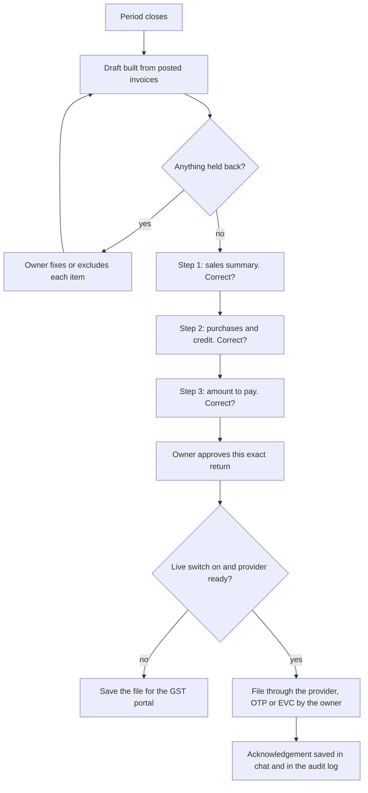

# Feature spec 03: GST returns, review and file

| | |
|---|---|
| Requirements | FR-GST-1 to 6 in the [product PRD](../PRD.md) |
| Status | Drafts, GSTR-1 file and the review built (2026-10-06); recording a filing and its ARN built (2026-10-07); set-off and live filing not built |
| Code | `platform/src/return-period.mjs`, `gstr1-json.mjs`, `tools.mjs` (`prepare_gstr1`, `prepare_gstr3b`, `gst_period_summary`, `filing_pack`), `action-gate.mjs`, `sprints/sprint-3-gst-recon`, `sprints/sprint-5-filing-assistant` |

## What the owner experiences

A few days before the due date the product says the return for the month is ready. It
shows the figures one step at a time and asks "Is this information correct?". The owner
answers by typing or by tapping an option. When every step is confirmed the owner
approves filing. The acknowledgement is saved in the chat.

## Flow

## Behaviour

### Draft (built)

- A return is built from one tax period only. `documentsForPeriod` selects by document
  date; the app shows one month at a time.
- GSTR-1 splits sales into the registered, large unregistered and summary tables using
  rates and thresholds read from dated rules on the invoice date.
- An invoice the return cannot carry (invalid GSTIN, rate not in force, missing place
  of supply) is held back with its reason and shown to the owner.
- The GSTR-1 file for the GST offline tool can be saved from the app.

### Review (built)

- `gst-review.mjs` builds the steps from the same period summary as the Taxes screen:
  invoices held out of the return (only when there are any), sales, purchases and input
  credit, then approval. Each step lists its figures and asks "Is this information
  correct?".
- Each answer carries a hash of the draft the owner saw (`draftHash`). If any document
  of that month changes afterwards, earlier answers stop counting, the screen says the
  books changed, and an answer sent against the old figures is refused. Another
  month's entries do not disturb the review.
- Steps go in order. "Something is wrong" records a note and keeps the step open; the
  owner fixes the entry in its chat and the step opens again with the new figures.
- Approval records who approved which draft and when. It files nothing and creates no
  portal approval; that is the action gate's job when live filing exists. When the
  member's role is known, only the owner (engine role `admin`) approves; staff and
  accountants can answer the other steps. This is provisional until PRD Q2 is decided.
- In the app the card is the preview: tapping an answer proposes it and confirms it at
  once, bound to the draft hash on screen. In chat, "review GST for September" shows the
  next step as a preview and "yes" confirms it; "no" records nothing.
- The input credit step says plainly that it has not been checked against GSTR-2B.

### Amount to pay (to build)

- Input credit must be set off against output tax head by head in the order the law
  prescribes (CGST Act s.49 and Rule 88A), with the cash ledger and credit ledger
  balances taken into account. This is not implemented; the app deliberately shows tax
  on sales and credit on purchases separately and says so.
- The set-off order, interest and late fee must be added as dated rules with golden
  cases and verified against the Act before any "amount to pay" is shown.
- QRMP businesses file quarterly with monthly payment; the review must follow the
  scheme the business is in.

### File (partly built)

- Filing is an external action. It passes the action gate: known action, preflight,
  live switch, approval bound to operation, business and payload hash, deadline, audit.
- The provider adapters run against a sandbox only. Live filing needs GSP/ASP
  onboarding.
- The owner's OTP or EVC is entered by the owner. The product never stores it.
- Until live filing exists, the end of the review is "Save the file", and the product
  says plainly that it has not filed anything.

## Recording a filing (built 2026-10-07)

Until MyCA files live, returns are filed on the portal or by the CA. The owner records
each one so MyCA stops treating it as due:

- `record_filing` (`filings.mjs`) takes the return, the period, the ARN and the filing
  date. The return must be one the deadlines engine lists for this business in the 24
  months before the filing date. It is refused when the ARN is not 10 to 20 letters and
  digits, when the date is in the future, when the return is already recorded, or when
  the ARN is already used. MyCA does not validate the ARN's internal structure.
- Recorded filings are laid over every deadline (`deadline-run.mjs`). The row becomes
  `filed`, with the ARN and whether it was filed after the due date. The overdue item
  leaves "needs you", the books check stops listing it, and a filed GSTR-3B is no
  longer projected as a payment in the cash forecast.
- An unrecorded return past its due date now reads "has no filing recorded", not
  "overdue": MyCA cannot tell whether it was filed.
- Chat: "filed GSTR-1 for September, ARN AA2909261234567", "GSTR-3B for 2026-09 filed
  by my CA, ack no …", "my filings". A month name is the most recent past one.
  Sentences with "not", "never", "haven't" are not read as filings.
- App: Taxes has a Filed section and "Record a filing", with the engine's preview first.

## Acceptance criteria

- Every figure in the review equals a recomputation from the period's invoices.
- Changing any invoice in the period after approval makes the approval unusable.
- With the live switch off, the flow ends at the saved file under every input.
- The acknowledgement number shown in chat is the one returned by the provider and is
  also in the audit log.
- A return for a period with held invoices cannot be approved until each is resolved or
  explicitly excluded by the owner.

## Out of scope

GSTR-9 and GSTR-9C, refunds, amendments to a filed return, composition scheme returns
(CMP-08, GSTR-4), responding to notices.

## Open questions

- Q2 in the PRD: may an invited CA approve filing, or only the owner?
- Is the first live release GSTR-1 only (no payment involved), with GSTR-3B following
  once set-off is verified? Engineering recommends this order.
