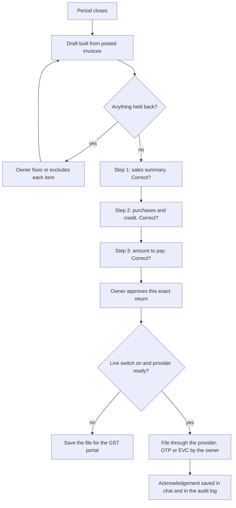

# Feature spec 03: GST returns, review and file

| | |
|---|---|
| Requirements | FR-GST-1 to 6 in the [product PRD](../PRD.md) |
| Status | Drafts and GSTR-1 file built; review in chat, set-off and live filing not built |
| Code | `platform/src/return-period.mjs`, `gstr1-json.mjs`, `tools.mjs` (`prepare_gstr1`, `prepare_gstr3b`, `gst_period_summary`, `filing_pack`), `action-gate.mjs`, `sprints/sprint-3-gst-recon`, `sprints/sprint-5-filing-assistant` |

## What the owner experiences

A few days before the due date the product says the return for the month is ready. It
shows the figures one step at a time and asks "Is this information correct?". The owner
answers by typing or by tapping an option. When every step is confirmed the owner
approves filing. The acknowledgement is saved in the chat.

## Flow

## Behaviour

### Draft (built)

- A return is built from one tax period only. `documentsForPeriod` selects by document
  date; the app shows one month at a time.
- GSTR-1 splits sales into the registered, large unregistered and summary tables using
  rates and thresholds read from dated rules on the invoice date.
- An invoice the return cannot carry (invalid GSTIN, rate not in force, missing place
  of supply) is held back with its reason and shown to the owner.
- The GSTR-1 file for the GST offline tool can be saved from the app.

### Review (to build)

- The review is a sequence of confirmation cards in the Taxes chat. Each card shows a
  few figures in plain words and offers "Yes, correct" and "Something is wrong".
- "Something is wrong" opens the entries behind the figure; a fix reposts and restarts
  the review from that step.
- The review state is stored per period with a hash of the draft. If the books change
  after a step was confirmed, the confirmation is void and the owner is told why.

### Amount to pay (to build)

- Input credit must be set off against output tax head by head in the order the law
  prescribes (CGST Act s.49 and Rule 88A), with the cash ledger and credit ledger
  balances taken into account. This is not implemented; the app deliberately shows tax
  on sales and credit on purchases separately and says so.
- The set-off order, interest and late fee must be added as dated rules with golden
  cases and verified against the Act before any "amount to pay" is shown.
- QRMP businesses file quarterly with monthly payment; the review must follow the
  scheme the business is in.

### File (partly built)

- Filing is an external action. It passes the action gate: known action, preflight,
  live switch, approval bound to operation, business and payload hash, deadline, audit.
- The provider adapters run against a sandbox only. Live filing needs GSP/ASP
  onboarding.
- The owner's OTP or EVC is entered by the owner. The product never stores it.
- Until live filing exists, the end of the review is "Save the file", and the product
  says plainly that it has not filed anything.

## Acceptance criteria

- Every figure in the review equals a recomputation from the period's invoices.
- Changing any invoice in the period after approval makes the approval unusable.
- With the live switch off, the flow ends at the saved file under every input.
- The acknowledgement number shown in chat is the one returned by the provider and is
  also in the audit log.
- A return for a period with held invoices cannot be approved until each is resolved or
  explicitly excluded by the owner.

## Out of scope

GSTR-9 and GSTR-9C, refunds, amendments to a filed return, composition scheme returns
(CMP-08, GSTR-4), responding to notices.

## Open questions

- Q2 in the PRD: may an invited CA approve filing, or only the owner?
- Is the first live release GSTR-1 only (no payment involved), with GSTR-3B following
  once set-off is verified? Engineering recommends this order.
