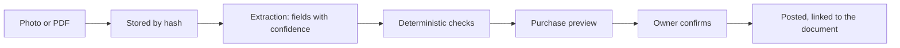

# Feature spec 09: Reading documents and POS sales

| | |
|---|---|
| Requirements | FR-CAP-1 to 3 in the [product PRD](../PRD.md) |
| Status | File imports built; reading a supplier invoice and POS sales not built |
| Code | Importers in `platform/src` (`import-zoho.mjs`, `tally-xml.mjs`, `post-import.mjs`, `import-documents.mjs`), `sprints/sprint-1-tally-ingestion`, `sprints/sprint-2-bank-ocr`; uploads in `cloud/src/api.mjs` |

## What the owner experiences

The owner forwards a supplier's invoice or photographs it. The product reads the
supplier, GSTIN, bill number, date, amounts and tax, and shows a purchase entry to
confirm. In a shop, each sale at the counter appears in the sales register on its own.

## User stories

1. As an owner, I photograph a bill and confirm what the product read.
2. As an owner, I forward a PDF invoice from WhatsApp or email into the app.
3. As a shop owner, my counter sales are in my books without my doing anything.
4. As an owner, I can always open the original document behind an entry.

## Behaviour

### Uploads and imports (built)

- A file is uploaded first and stored by its sha256; an import refers to it by hash.
  Every read re-verifies the hash.
- Tally day book, Zoho Books invoices, bank statements and purchase registers import
  into previews. Importing the same file twice posts nothing.
- A row that cannot be read with certainty is held back and shown with its reason.

### Reading a supplier invoice (to build)

- Extraction returns fields, not entries: supplier name, GSTIN, bill number, date,
  line amounts, each tax head, total.
- Deterministic checks run on the fields before any preview: the GSTIN checksum, the
  tax heads against the place of supply, the rate in force on the bill date, the
  arithmetic (lines plus tax equals total), and a duplicate bill number for that
  supplier.
- A field that fails a check or has low confidence is shown as a question on the
  preview. The engine recomputes every total; an extracted total is only compared.
- The entry keeps a link to the document hash so the original is one tap away.
- The extraction service is behind an interface so the model can change. What may be
  sent to it, and where it runs, is PRD question Q3.

### Forwarding into the app (partly built)

A documents key (Connections in the app) lets a mail relay or scanner post a file to
`POST /v1/inbound/documents`; the file is stored and the owner gets a reminder to read
it (2026-10-15). Registering the app as a share target for images and PDFs, and a
per-business email address on the hosted service, are still to build.

### POS sales (built 2026-10-15, except the daily file)

- An inbound API per business with a signed secret: a POS posts a sale, the product
  creates the sales entry. Idempotent on the POS's own sale id. (`POST /v1/inbound/sales`
  with a key made under Connections; the owner sees today's count and total per key and
  turns a key off there.)
- Counter sales to unregistered buyers are recorded individually and reported in the
  return's summary table by the existing GSTR-1 logic.
- A daily summary import (file) for POS systems with no API.
- This is the one flow where entries post without a per-entry confirmation. The owner
  turns it on per POS, sees a daily total to confirm, and can turn it off.

## Acceptance criteria

- For a test set of real invoices, no entry posts with a wrong GSTIN, tax head or total
  without the owner having been shown the doubt.
- The same bill photographed twice produces one entry.
- A POS sale delivered twice produces one entry.
- Every purchase entry created from a document opens that document.

## Out of scope

Reading handwritten bills, bank statement PDFs by image, e-commerce marketplace
settlement reports.

## Open questions

- Q3 and Q7 in the PRD.
- How long are document images kept, and may the owner delete one that backs a posted
  entry? This belongs in the retention policy.
